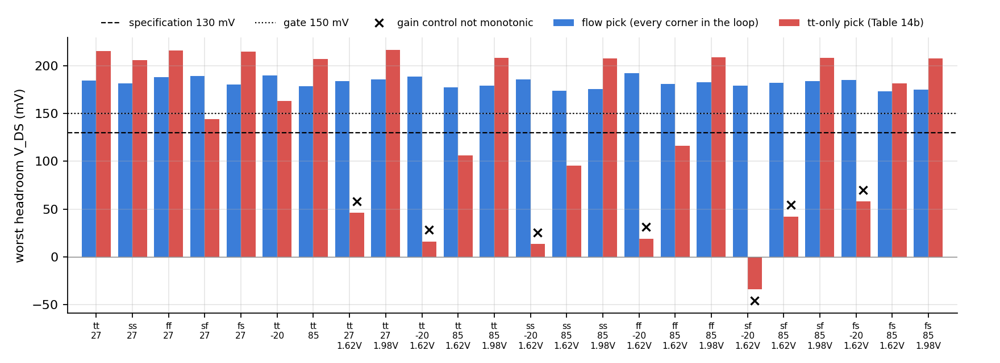
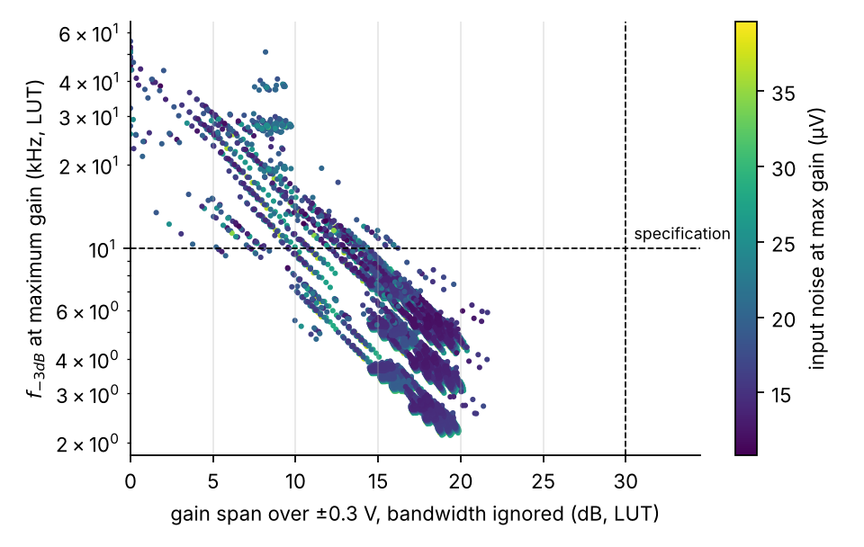
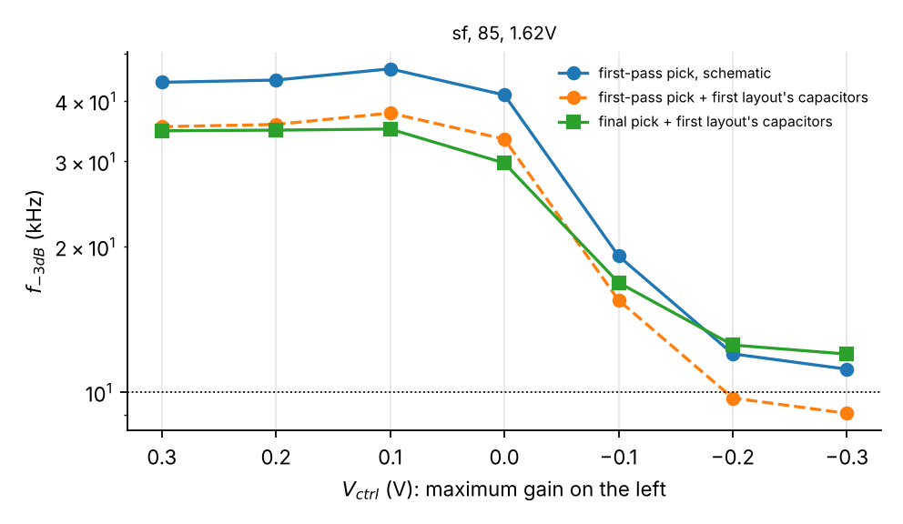
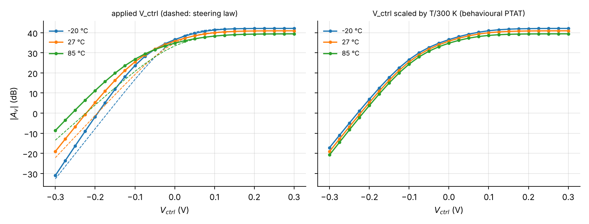
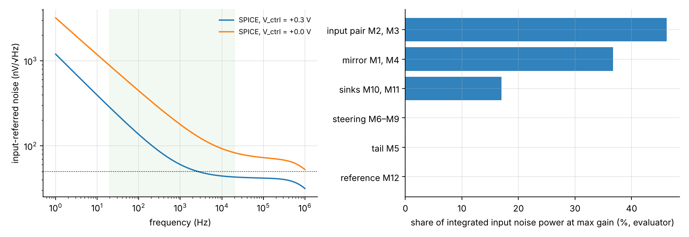
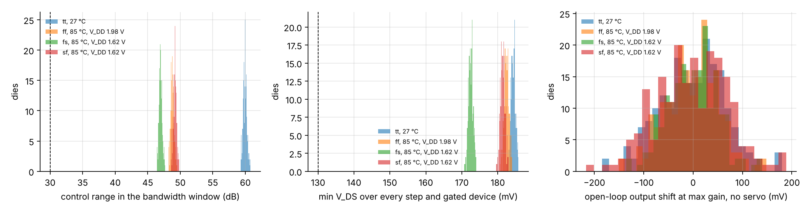

# Every-corner gm/ID sizing with layout in the loop: a subthreshold current-steering VGA core (SKY130)

IEEE SSCS Code-a-Chip, ISSCC 2027. Notebook: `notebook.ipynb`. License: Apache-2.0.

 runs tier 1 (cached results, no SPICE).

**Team:** Ayush Krishna Balabadra (team representative and travel-grant recipient) and Vrinda Pandey, VIT Vellore.

**Scope:** the gain core of a hearing-aid compressor and the flow that sizes it. No envelope detector or gain-control
loop, so no compression behaviour is claimed.

## One sizing and one layout that hold at every corner: an open flow from specification to signed-off layout
**The circuit.** A 12-transistor subthreshold variable-gain amplifier (VGA) core in SKY130: the stage of a hearing-aid compressor that sets how much the audio signal is amplified, controlled by a voltage, on less than 5 µA from 1.8 V. Subthreshold gives the most transconductance per unit of current, but it makes the circuit very sensitive to process, temperature and supply.

**The flow.** It sizes the core once for all 24 process, temperature and supply corners, lays it out, feeds the layout back into the sizing and signs it off; everything reruns from cached simulations in about a minute. It was inspired by the Code-a-Chip lookup-table flows of Adair (ISSCC'25) and Elhelly (ISSCC'26) and extends their idea to one sizing and one layout for every corner at once (the notebook's reuse table lists what we took and what we added).

**Result (SPICE, all 24 corners):** control range ≥ **47.0 dB**, bandwidth ≥ **11.8 kHz**, headroom ≥ **173 mV**, supply **4.63–4.83 µA**; NEF **4.08** at tt. The layout is DRC- and LVS-clean, and its capacitance-extracted netlist passes all 24 corners.

**What makes the flow different**
1. **It designs for every corner, not for tt.** All 24 corners are inside the search. Sized at tt alone, on the same grid, model, margins and pick rule, the design passes at tt but fails 11 of 24 corners in SPICE, 10 of them even without the flow's headroom margin (Table 14b, Figure 7c below). Our pick passes all 24 gate corners and 21 of 21 held-out stress corners.
2. **Its tables are exact, and their error is measured.** SKY130 picks a model bin from each finger's width, so a table made at one width is wrong at another; building every transistor from whole 5 µm fingers makes the tables exact. The table model is within **0.40 dB** (gain) and **1.3 %** (noise) of SPICE on 42 random designs; it can over-estimate bandwidth by up to 17 %, so SPICE decides every pick (§5–§6).
3. **It tells you when a circuit cannot work, and why.** None of 12,164 sizings of the hand-designed nine-transistor core reaches the 30 dB control range (best 10.4 dB): its gain hits a floor. That diagnosis led us to a 12-transistor core, which the flow then sized (§7–§8).
4. **The layout is part of the loop.** The first layout's 207 fF of output wiring broke the pick at 6 of 24 corners; it went back into the flow and the new pick passes (§9.3). Sign-off: DRC-clean on 3 rule decks, LVS-clean (6 of 6 deliberately altered netlists rejected); with resistance extracted too, the gate passes at the 3 corners that bound it (§13).
5. **Reproducible by construction.** Every table and figure is rebuilt from `cache/` by the code in this folder, every number in these summaries is read from `cache/results.json`, and the same code sizes other specifications or reports why none exists (§11).

**What does not hold:** noise density 60 against 50 nV/√Hz at 1 kHz; the 7 µV integrated-noise target is met at tt but exceeded at 13 of 24 corners (8.4 µV at the noisiest); 4.95 µA with 3σ mismatch against a 5 µA limit; Monte Carlo, control port, PSRR and CMRR are schematic-level, and Monte Carlo passes behind an ideal output DC servo that is not built; this is a gain core, not a full compressor (§14).

| From hand-sized to flow pick | 9T baseline (hand) | 12T hand screen (8 Oct) | 12T flow pick |
|:--|:--:|:--:|:--:|
| Control range in the bandwidth window, worst corner (dB) | -9.1 | 18.4 | 47.0 |
| f-3dB at maximum gain, worst corner (kHz) | 2.6 | 12.9 | 34.3 |
| Headroom, every step, worst corner (mV) | 4 | -63 | 173 |
| Corners passing the gate | 0 of 24 | 0 of 24 | 24 of 24 |
| Integrated input noise, max gain, tt (µV) | 29.1 | 26.8 | 6.9 |
| Supply current, worst corner (µA) | 6.18 | 5.64 | 4.83 |
| Drawn gate area (µm²) | 75 | 398 | 17,120 |

*The 9T column is the hand-sized baseline at its worst corner (SPICE); the 10.4 dB of finding 3 is the best of the 12,164 sizings at tt (table model).*

*Worst headroom at each corner (Figure 7c of the notebook). Red: sized at tt alone; blue: the flow's pick.*

## Specification compliance (SPICE, schematic level, 24 corners)

| Parameter | Target | 9T baseline (hand) | 12T hand screen (8 Oct) | 12T flow pick | met: 9T | met: hand 12T | met: pick |
|:--|:--:|:--:|:--:|:--:|:--:|:--:|:--:|
| Supply current, worst corner (nominal) | report | 6.18 µA | 5.64 µA | 4.83 µA | — | — | — |
| Supply current + 3σ local mismatch, worst corner | ≤ 5 µA | — | — | 4.95 µA | — | — | ✅ |
| Control range in the bandwidth window, worst corner | ≥ 30 dB | -9.1 dB | 18.4 dB | 47.0 dB | ❌ | ❌ | ✅ |
| f-3dB at every gain step in the window, worst corner (C_L 1 pF; the pick with the layout wiring added) | ≥ 10 kHz | — | 10.3 kHz | 11.8 kHz | ❌ | ✅ | ✅ |
| f-3dB at maximum gain, worst corner | report | 2.6 kHz | 12.9 kHz | 34.3 kHz | — | — | — |
| Headroom V_DS at every control step, worst corner | ≥ 130 mV | 3.7 mV | -62.8 mV | 173.0 mV | ❌ | ❌ | ✅ |
| Corners passing the full gate (process, temperature, supply) | report | 0 of 24 | 0 of 24 | 24 of 24 | — | — | — |
| Maximum gain (tt) | report | 58.2 dB | 47.1 dB | 40.9 dB | — | — | — |
| Integrated input noise, max gain (tt) | ≤ 7 µV | 29.1 µV | 26.8 µV | 6.9 µV | ❌ | ❌ | ✅ |
| Input noise density at 1 kHz, max gain | ≤ 50 nV/√Hz | 348 nV/√Hz | 312 nV/√Hz | 60 nV/√Hz | ❌ | ❌ | ❌ |
| NEF, max gain | ≤ 5 | 11.3 | 14.9 | 4.1 | ❌ | ❌ | ✅ |
| Output swing at THD 1 %, max gain | report | 52 mV pk | 146 mV pk | 105 mV pk | — | — | — |
| Dynamic range at max gain (1 % THD swing over input noise) | report | 3.9 dB | 24.7 dB | 39.7 dB | — | — | — |
| Input offset, 1σ, max gain | report | 3.35 mV | — | 0.58 mV | — | — | — |
| Open-loop output DC spread, 1σ, max gain | report | 2621 mV | — | 65 mV | — | — | — |

Every claim above is listed, with the test that checks it, in the notebook's claims ledger (Table 24).

## The pick: devices and bias (every width is whole 5 µm fingers)

| Device(s) | Role | W (µm) | L (µm) | Copies m |
|:--|:--:|:--:|:--:|:--:|
| M2, M3 | input pair | 128 × 5 = 640 | 8 | 1 |
| M6–M9 | steering | 4 × 5 = 20 | 2 | 1 |
| M1, M4 | PMOS mirror | 128 × 5 = 640 | 0.5 | 1 |
| M5 | tail (unit copies) | 8 × 5 = 40 | 8 | 14 |
| M10, M11 | keep-alive sinks (unit copies) | 8 × 5 = 40 | 8 | 2 |
| M12 | reference diode (unit) | 8 × 5 = 40 | 8 | 1 |

| Bias | Value |
|:--|:--:|
| V_DD | 1.8 V |
| input common mode | 0.75 V |
| steering common mode | 1.05 V |
| reference current I_ref (into the iref pin) | 0.25 µA |

LVS reference netlist: `layout/vga_core_12t.spice` (generated by the notebook). Final layout: `layout/vga_core_12t.gds`
(gLayout generator in `layout/generator/`); sign-off reports, proof files and the extracted netlist in `layout/reports/`.

## Figures

**The flow**

**Device tables; current density versus finger width**

**Evaluator against SPICE**

**Hand-sized 9T: the gain floor**

**No 9T sizing meets the specification**

**The 12T flow: grid, extension and the first pass's pick**

**Sized at tt alone against the flow's pick: worst headroom at every corner**

**Layout in the loop: the first layout's wiring and the two picks**

**The final layout (layout/vga_core_12t.gds)**

**Gain law over temperature, with and without PTAT control**

**Noise of the pick**

**Monte Carlo with the PDK mismatch model**

**The control port: feedthrough and gain steps**

## Reproduce
* Tier 1 (Python only, about a minute): `pip install -r requirements.txt`, open `notebook.ipynb`, Run All.
* Tier 2/3 (IIC-OSIC-TOOLS container): `python tools/run_nb.py --mode spice` or `--mode full`; or set `RERUN_SPICE`,
  `REBUILD_LUT`, `RERUN_FLOW` in §2 and Run All. `python tools/run_flow.py` runs the flow alone and
  `python tools/verify_pick.py` the pick's Monte Carlo, control-port and stress checks.
* Layout: `python tools/run_nb.py --mode layout` (or `python tools/postlayout_pick.py --rerun`) reruns the post-layout
  gate on the committed extraction (ngspice + SKY130). DRC, LVS and extraction rerun with the layout author's scripts
  in `layout/generator/`, as in `layout/README.md` (IIC-OSIC-TOOLS); `python tools/import_signoff.py` reads their
  reports into `layout/layout_report.json`.
* Table 1 of the notebook records the toolchain of the last run; Table 1b where the flow caches were produced.

## Repository contents
`scripts/` all simulation and flow logic; `tools/` headless runners, the flow CLI and the lint; `cache/` the device
tables, screens and every simulation result; `images/` every figure; `schematic/` the xschem drawings of Figures 1
and 6 (`tools/schematics.py` writes the sizes in, checks them against the LVS netlist and renders the figures);
`layout/` the generated LVS netlist and sizes file, the final layout, its generator (`layout/generator/`) and sign-off
(`layout/reports/`); `layout/layout1/` the first layout (an interim sizing), whose extraction feeds §9.3.
